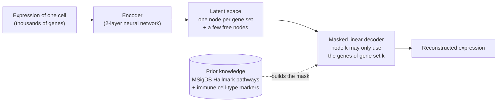
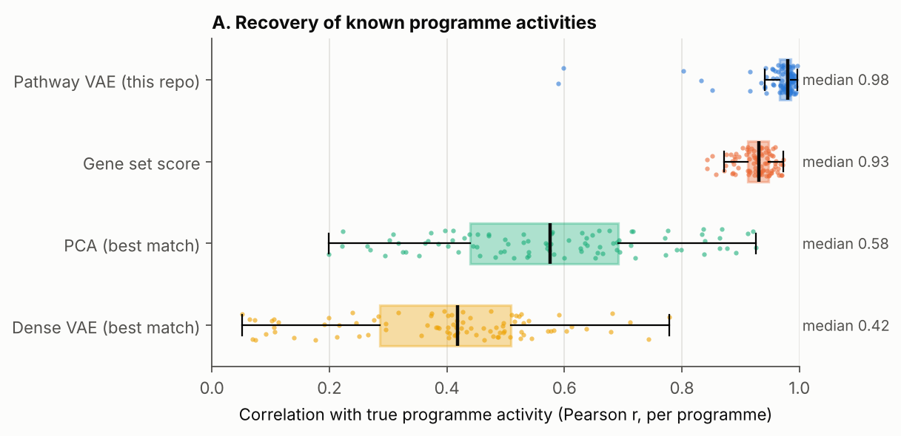
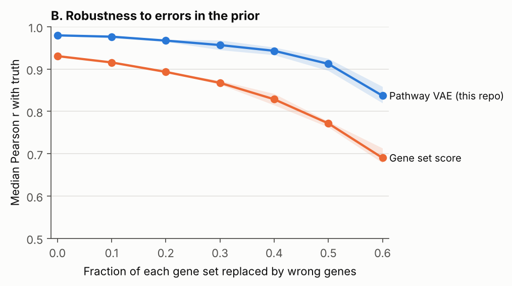
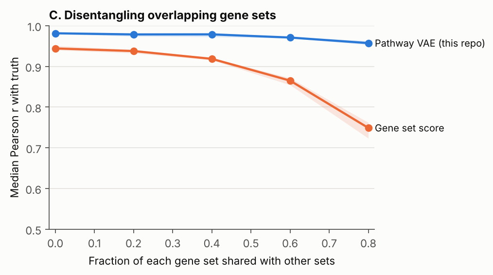
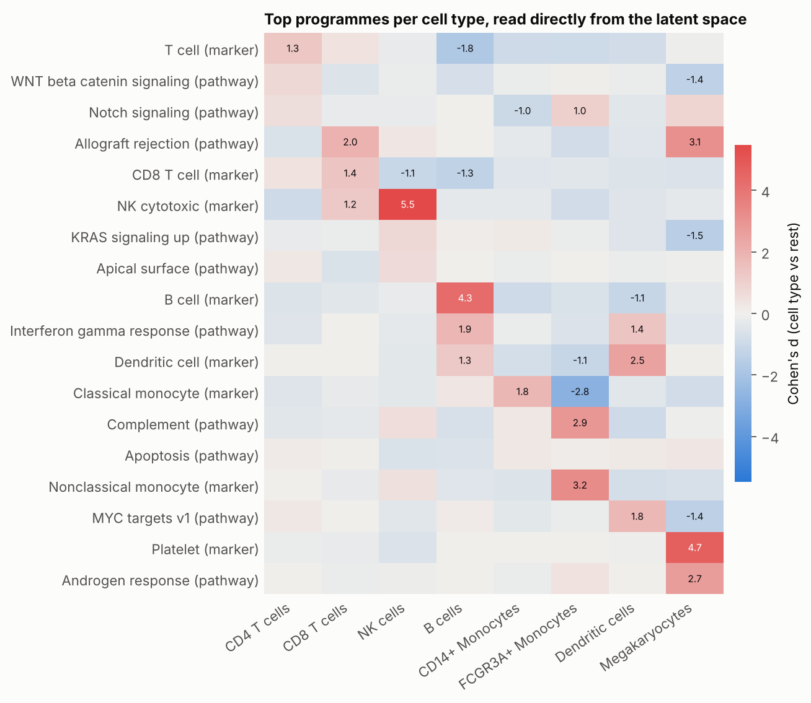
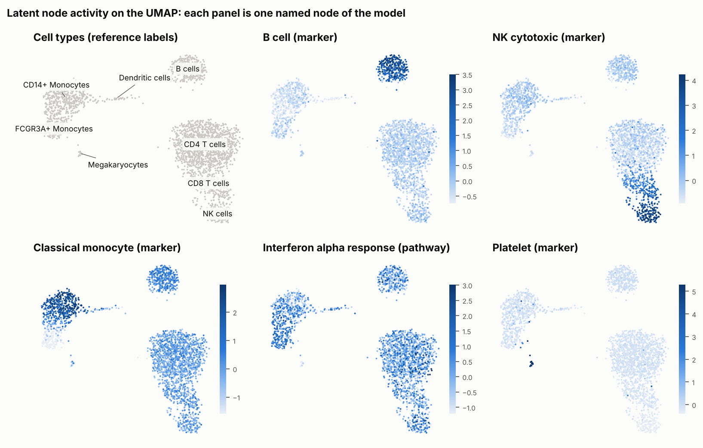

# pathway-vae: interpretable-by-design deep learning for single-cell RNA-seq

[](https://github.com/nsarmadfar/pathway-vae/actions/workflows/tests.yml)

A variational autoencoder whose latent space is **named by prior biological knowledge**. Every latent dimension is
tied to one pathway or cell-type gene programme, so the model's internal representation of a cell can be read
directly as "how active is each programme in this cell", without any post hoc explanation step.

**Key results**

* On simulated data with known ground truth, the model recovers per-cell programme activity with a median
  correlation of **0.98**, compared with 0.93 for standard gene set scoring and 0.42 to 0.58 for black-box
  embeddings, even when those are given the best possible matching to the truth.
* It degrades gracefully when the prior knowledge is wrong (median r = 0.94 with 40% of every gene set replaced by
  wrong genes) and keeps overlapping gene sets apart where simple scoring fails (0.96 vs 0.75 at 80% overlap).
* On human PBMCs it ranks each cell type's own marker programme first or second without ever seeing cell-type
  labels, keeps most of the cell-type information of an unconstrained VAE (balanced accuracy 0.87 vs 0.90), and its
  latent dimensions are **far more reproducible across random seeds** (r = 0.92 vs 0.29).

---

## Why

Most deep learning for single-cell data follows a "train a black box, explain it afterwards" recipe. That has two
problems: post hoc explanations are not always possible or reliable, and the model has to rediscover well-known
biology from scratch on every dataset. The alternative is to **build known biology into the architecture** so the
model is interpretable by construction. This repository is a compact, tested implementation of that idea, in the
spirit of VEGA (Seninge et al., 2021) and expiMap (Lotfollahi et al., 2023), together with in silico experiments
that measure when it works and when it does not.

## How it works



* **Encoder:** an ordinary nonlinear network, so the model is still flexible.
* **Decoder:** one linear layer, multiplied element-wise by a fixed binary mask built from gene sets. Latent node *k*
  can only reconstruct the genes of gene set *k*, which gives every node a biological name.
* **Non-negative decoder weights** (via softplus) make the sign readable: a higher node value always means higher
  expression of that programme's genes.
* **Free nodes** with an L1 penalty absorb real variation that the gene sets do not describe, so it is not forced
  into the wrong programme.
* **Interpretation** comes for free: per-cell programme activities (latent means), differential activity between
  groups, and the decoder weights, which show which members of a gene set actually carry the signal in a dataset.

The same training loop also trains a **dense VAE** baseline with an identical architecture except for the mask, so
every comparison isolates the effect of the prior knowledge.

## Results

### 1. In silico experiments with known ground truth

Real data never reveals the true activity of a pathway in each cell, so the method is first tested on simulated
data that does. The simulator (`src/pathvae/simulate.py`) reproduces what makes real gene sets hard to use:
overlapping sets, only part of each set responding, cell-type-specific and continuous programmes, and extra
programmes that are missing from the prior. Each setting is repeated with 3 random seeds (30 programmes each).

**A. Recovery of programme activity.** Each point is one programme in one seed.



| Method | Median r | IQR |
|---|---|---|
| Pathway VAE (this repo) | 0.980 | 0.967 to 0.986 |
| Gene set score (mean z-score of set genes) | 0.931 | 0.913 to 0.947 |
| PCA, best match to truth | 0.576 | 0.440 to 0.692 |
| Dense VAE, best match to truth | 0.417 | 0.286 to 0.509 |

PCA and the dense VAE have unnamed dimensions, so each true programme was matched to its best-correlating dimension
using the ground truth (Hungarian matching). That is an upper bound a user with real data could never reach, and
they still fall far behind. A few programmes (min r = 0.59) are recovered less well by the pathway VAE; a likely
cause is hidden, unannotated signal that overlaps with an annotated set, which is worth investigating further.

**B. Robustness to wrong prior knowledge.** Pathway databases are incomplete and noisy. Here a growing fraction of
every gene set is replaced by random wrong genes before training; activities are still scored against the truth.



The model stays above r = 0.94 with 40% of each gene set wrong, while gene set scoring drops to 0.83. Because the
decoder learns a weight for every gene, it can effectively switch off genes that do not follow the programme.

**C. Overlapping gene sets.** Real pathways share many genes (e.g. interferon alpha and gamma responses).



Gene set scoring cannot tell which programme a shared gene responds to and falls to r = 0.75 at 80% overlap. The
model explains all genes jointly and stays at 0.96.

### 2. Human PBMCs (10x Genomics PBMC 3k)

2,638 cells, 4,660 genes (2,000 highly variable genes plus every gene that belongs to a gene set), 58 gene sets
(50 MSigDB Hallmark pathways and 8 canonical immune cell-type marker programmes) and 5 free nodes. Models were
trained on 80% of cells; reconstruction error is measured on the held-out 20%. Mean over 3 seeds. (CPU training is not bit-for-bit deterministic, so a rerun can differ in the second
decimal.)

| Method | Named, interpretable dimensions | Cell-type balanced accuracy (linear classifier, 5-fold CV) | Held-out reconstruction MSE | Reproducibility of dimensions across seeds (r) |
|---|---|---|---|---|
| Pathway VAE (this repo) | yes | 0.875 ± 0.012 | 0.192 | **0.92** |
| Dense VAE | no | 0.899 ± 0.006 | 0.186 | 0.29 (best match) |
| PCA | no | 0.900 ± 0.006 | 0.181 | not applicable |
| Gene set score | yes | 0.864 ± 0.006 | not applicable | not applicable |

**The trade-off is small and explicit.** Constraining the decoder costs about 2.5 points of balanced accuracy and
3.5% in reconstruction error compared with an unconstrained VAE of the same size. In return every dimension has a
biological name, and the same dimension means the same thing across training runs: the activity of a given pathway
correlates at r = 0.92 between seeds, whereas the dense VAE's dimensions are essentially arbitrary (r = 0.29 even
after optimal matching).

**Programmes per cell type, read directly from the latent space** (one-vs-rest Cohen's d, all shown programmes
FDR < 0.05, Mann-Whitney U with Benjamini-Hochberg correction):





* For **7 of the 8 cell types the most up-regulated programme is the cell type's own marker programme** (for example
  NK cytotoxic in NK cells, d = 5.5; B cell in B cells, d = 4.3; platelet in megakaryocytes, d = 4.7), recovered
  without the model ever seeing a cell-type label. In CD8 T cells the CD8 marker programme ranks second (d = 1.4)
  behind Hallmark allograft rejection (d = 2.0), which itself contains CD8A, CD8B, GZMA, GZMB and PRF1 and so
  describes the same cytotoxic T-cell biology.
* Biologically coherent pathways appear alongside: complement in FCGR3A+ monocytes (d = 2.9) and MYC targets in
  dendritic cells (d = 1.8).
* **Driver genes** (decoder weights) show which members of a large gene set carry the signal in this dataset.
  For interferon alpha response the top genes are ISG15, LY6E, IFITM1, UBE2L6, ISG20 and MX1, the classic
  interferon-stimulated genes; for the NK programme they are NKG7, GNLY, GZMB, CST7 and PRF1
  (`results/tables/pbmc_driver_genes.csv`).

**Where the prior misleads, and why that is useful to see.** The model ranks "interferon gamma response" as highly
active in B cells and dendritic cells. That is not evidence of interferon signalling: the Hallmark set contains MHC
class II genes (HLA-DRB1, HLA-DQA1, HLA-DMA, CD74, CIITA), which antigen-presenting cells express constitutively.
The "allograft rejection" and "androgen response" signals in megakaryocytes have no clear biological reading either;
that group has only 15 cells, so these effect sizes are fragile and best treated as artefacts. Because the model is transparent, these artefacts
are easy to diagnose from the decoder weights, which would not be possible with a black box. Handling them properly
(for example with hierarchical or cell-type-aware gene sets) is one of the open problems listed below.

## Limitations and next steps

* **Likelihood.** The model uses a Gaussian loss on log-normalised data. A negative binomial or zero-inflated
  likelihood on raw counts would be more faithful to scRNA-seq.
* **Gene set selection.** All 58 sets are kept. A group-lasso penalty on each set's decoder weights (as in expiMap)
  would switch off programmes that are not used and make the model choose between overlapping sets.
* **Richer priors.** Pathway databases describe genes as unordered lists. Transcription-factor regulons, signed
  interactions or pathway hierarchies would let the decoder carry more biology, and multiple omics layers
  (for example chromatin accessibility) could share the same named latent space.
* **Scale and integration.** PBMC 3k is small. Next steps are larger atlases, batch-aware training and query
  mapping, and a direct comparison with expiMap and VEGA on the same benchmarks.

## Reproduce

```bash
git clone https://github.com/nsarmadfar/pathway-vae.git
cd pathway-vae
pip install -e ".[dev]"          # Python >= 3.10; installs PyTorch, scanpy, scikit-learn
pytest -q                        # 8 unit and end-to-end tests, under a minute

python experiments/01_simulation.py   # in silico experiments, 15 to 20 min on a laptop CPU
python scripts/download_data.py       # PBMC 3k and MSigDB Hallmark gene sets
python experiments/02_pbmc.py         # PBMC analysis, about 25 min on a laptop CPU
```

Both experiment scripts accept `--quick` for a fast smoke test and `--plot-only` to redraw figures from saved
results. All numbers in this README come from the files in `results/tables/`.

### Using it on your own data

```python
import torch
from pathvae import PathwayVAE, TrainConfig, build_mask, fit, read_gmt
from pathvae.interpret import differential_activity, driver_genes

gene_sets = read_gmt("my_gene_sets.gmt")
mask = build_mask(gene_sets, adata.var_names, min_genes=5, n_free=5)
model = PathwayVAE(torch.tensor(mask.mask), n_free=5)
fit(model, X_lognorm, TrainConfig(epochs=300))           # X: cells x genes, log-normalised

activity = model.latent(torch.tensor(X_lognorm)).numpy()  # cells x programmes, columns = mask.node_names
diff = differential_activity(activity[:, :mask.n_sets], adata.obs["cell_type"], mask.set_names)
```

## Repository layout

```
src/pathvae/
  genesets.py    read GMT files, build the gene set mask
  model.py       PathwayVAE (masked decoder) and DenseVAE baseline
  train.py       training loop with KL warm-up
  interpret.py   differential programme activity, driver genes, FDR
  simulate.py    simulator with ground-truth programme activities and noisy priors
  baselines.py   gene set scoring, PCA, evaluation metrics
experiments/     01_simulation.py, 02_pbmc.py (all figures and tables)
data/gene_sets/  curated PBMC marker programmes (Hallmark is downloaded)
results/         figures/ and tables/ produced by the experiments
tests/           pytest suite, run on every push by GitHub Actions
```

## References

* Kingma & Welling (2014). Auto-encoding variational Bayes. *ICLR*.
* Seninge et al. (2021). VEGA is an interpretable generative model for inferring biological network activity in
  single-cell transcriptomics. *Nature Communications* 12, 5684.
* Lotfollahi et al. (2023). Biologically informed deep learning to query gene programs in single-cell atlases.
  *Nature Cell Biology* 25, 337-350.
* Liberzon et al. (2015). The Molecular Signatures Database Hallmark gene set collection. *Cell Systems* 1, 417-425.
* PBMC 3k dataset: 10x Genomics, via the scanpy and cellxgene example data.

## Author

Nargess Sarmadfar. Questions and suggestions are welcome via GitHub issues.
